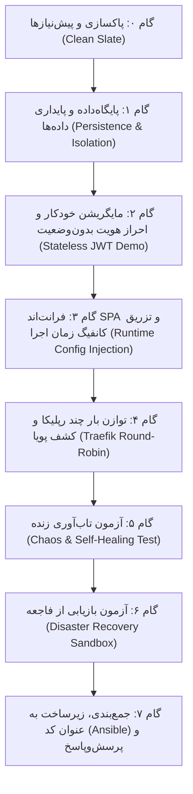

# 🎬 راهنمای جامع و سناریوی اجرای دموی زنده پروژه (Local DevOps Demo Playbook)

این مستند، راهنمای گام‌به‌گام و عملیاتی برای **اجرای یک دموی زنده، کامل و بی‌نقص به صورت محلی (Local)** است.
تمامی دستورات، خروجی‌های واقعی، مفاهیم علمی مرتبط برای توضیح به حضار و نکات کلیدی برای دفاع در برابر داوران و اساتید در این راهنما آورده شده است.

---

## 🧭 نقشه راه دمو و زمان‌بندی (مجموعاً ۱۵ الی ۲۰ دقیقه)



---

## 🖥️ آماده‌سازی دسکتاپ قبل از شروع ارائه (Screen Setup)

برای تسلط کامل در حین ارائه، صفحه نمایش خود را به دو بخش تقسیم کنید:

1. **نیمه سمت چپ (ترمینال دو پنجره‌ای):**
   * **پنجره بالا (Command Console):** اجرای گام‌به‌گام دستورات دمو.
   * **پنجره پایین (Live Monitor):** اجرای دستور زیر برای مشاهده زنده وضعیت کانتینرها در هر لحظه:
     ```bash
     watch -n 1 "docker ps --format 'table {{.Names}}\t{{.Status}}\t{{.Ports}}'"
     ```
2. **نیمه سمت راست (مرورگر وب):**
   * **تب اول:** صفحه اصلی پورتال کاربری (`http://localhost:8000`)
   * **تب دوم:** داشبورد مانیتورینگ زنده Traefik (`http://localhost:8081/dashboard/`)

---

## 🎬 مراحل گام‌به‌گام اجرای دمو

---

### گام ۰: آماده‌سازی محیط و شروع از وضعیت صفر (Clean Slate)
* **هدف:** اثبات اینکه هیچ کانتینر یا وابستگی پنهانی از قبل در حال اجرا نیست و سیستم کاملاً خودکار استقرار می‌یابد.

#### ۱. دستور ترمینال:
```bash
cd /mnt/e/Projects/deploy-with-agent/app

# خاموش کردن و حذف کانتینرها و شبکه‌های قبلی
docker compose -f docker-compose.local.yml down -v 2>/dev/null || true

# اطمینان از وجود فایل تنظیمات متغیرهای محیطی
cp -n .env.example .env 2>/dev/null || true
```

#### ۲. سناریوی گفتار برای حضار:
> «سلام به همگی. در این ارائه می‌خواهیم به صورت زنده یک زیرساخت نرم‌افزاری مقیاس‌پذیر، امن و آماده پروداکشن را بر پایه اصول داکر و معماری ابری پیاده کنیم. برای شروع، کل محیط را پاکسازی کردیم تا نشان دهیم سیستم ما هیچ وابستگی پنهانی ندارد و از نقطه صفر بالا می‌آید.»

---

### گام ۱: پایگاه‌داده، امنیت پورت‌ها و پایداری داده (Database & Persistence)
* **هدف:** تبیین تفاوت کانتینر با ماشین مجازی، امنیت پورت‌ها در داکر و نحوه ذخیره امن اطلاعات با Named Volume.

#### ۱. دستور ترمینال:
```bash
# اجرای سرویس دیتابیس در پس‌زمینه
docker compose -f docker-compose.local.yml up -d postgres

# بررسی وضعیت سلامت (Healthcheck)
docker compose -f docker-compose.local.yml ps postgres
```

#### ۲. خروجی مورد انتظار:
```text
NAME             IMAGE                STATUS                   PORTS
local_postgres   postgres:16-alpine   Up 4 seconds (healthy)   5432/tcp
```

#### ۳. نکات کلیدی برای توضیح:
* **کانتینر در برابر ماشین مجازی (VM vs. Container):** کانتینر یک پردازه استاندارد لینوکسی است که روی کرنل مشترک هاست اجرا می‌شود و به کمک **Namespaces** (برای تفکیک شبکه، فایل‌سیستم و پردازه‌ها) و **cgroups** (برای محدود کردن سقف مصرف RAM و CPU) کاملاً ایزوله شده است.
* **امنیت پورت‌ها (Network Isolation):** در خروجی دقت کنید پورت ۵۴۳۲ هاست باز نشده است (`ports:` ندارد). دیتابیس در شبکه خصوصی داکر (`app-net`) مخفی است و فقط کانتینرهای مجاز می‌توانند با آن صحبت کنند.
* **حل چالش یکبارمصرف بودن (Persistent Volume):** کانتینرها نباید شبیه حیوان خانگی (Pet) باشند بلکه باید مانند احشام (Cattle) در صورت خرابی فوراً تعویض شوند. داده‌های پایدار دیتابیس روی یک Named Volume مستقل به نام `local_pgdata` ذخیره می‌شوند تا با خاموش یا تعویض شدن کانتینر، داده‌ها هرگز پاک نشوند.

---

### گام ۲: مایگریشن خودکار، معماری Stateless و امنیت توکن‌ها (Auth & JWT)
* **هدف:** نشان دادن کانتینر کوتاه‌مدت Migration، معماری بی‌حالت بک‌اند و اجرای اسکریپت تست لاگین با دریافت JWT.

#### ۱. دستور ترمینال:
```bash
# اجرای مایگریشن اسکیما و راه‌اندازی کانتینر بک‌اند
docker compose -f docker-compose.local.yml up -d backend

# اجرای اسکریپت تست خودکار ثبت‌نام، ورود و احراز هویت با curl
bash scripts/demo_login.sh
```

#### ۲. خروجی مورد انتظار:
```text
============================================================
🔐 اجرای آزمون احراز هویت بدون وضعیت (Stateless JWT Demo)
   Target Server: http://localhost:8000
   Username     : demo_student
============================================================

[۱/۳] تلاش برای ثبت‌نام یا ورود کاربر...
✓ احراز هویت با موفقیت انجام شد (HTTP 200)
   شناسه پاد پاسخ‌دهنده (Pod ID): 53a2a23e890c

[۲/۳] توکن دسترسی JWT دریافت شده:
eyJhbGciOiJIUzI1NiIsInR5cCI6IkpXVCJ9.eyJzdWIiOiI1YzhjMTc0Ni...
   توضیح: توکن با پیشوند استاندارد eyJ... (فرمت Base64Url هدر JWT) آغاز می‌شود.

[۳/۳] تست فراخوانی اندپوینت حفاظت‌شده با Bearer Token...
✓ توکن معتبر است و هویت با موفقیت تأیید شد:
   پاسخ پروفایل: {"username":"demo_student","podId":"5812e91e797d"}

============================================================
🎉 آزمون موفق! سیستم احراز هویت کاملاً درست کار می‌کند.
============================================================
```

#### ۳. نکات کلیدی برای توضیح:
* **کانتینر مستقل Migration:** تغییرات دیتابیس توسط کدهای در حال اجرای بک‌اند اعمال نمی‌شوند؛ یک کانتینر موقت (`migrate`) قبل از بالا آمدن بک‌اند اجرا شده، اسکریپت‌های اسکیما را بررسی می‌کند و با موفقیت به کار خود پایان می‌دهد (`restart: no`).
* **معماری بدون‌وضعیت (Stateless Backend):** هیچ سشنی در حافظه RAM سرور نگهداری نمی‌شود.
* **امنیت دو لایه‌ای توکن‌ها:**
  * **Access Token (JWT):** کوتاه‌مدت (۱۵ دقیقه) که درون هدر `Authorization: Bearer` ارسال می‌شود.
  * **Refresh Token:** در کوکی محافظت‌شده با فلگ‌های `HttpOnly` (غیرقابل خواندن با اسکریپت‌های نفوذی JS جهت جلوگیری از سرقت در حملات XSS) و `SameSite=Strict`.
* **کشف سرقت توکن (Token Family Theft Detection):** در صورت استفاده مجدد یا نامعتبر از یک Refresh Token، سیستم متوجه نشت امنیتی شده و تمام توکن‌های آن خانواده را بلافاصله ابطال می‌کند.

---

### گام ۳: فرانت‌اند تک‌صفحه‌ای (SPA) و تزریق تنظیمات در زمان اجرا
* **هدف:** نمایش رابط کاربری مدرن فرانت‌اند و حل چالش متغیرهای محیطی در کدهای سمت کلاینت.

#### ۱. دستور ترمینال:
```bash
# اجرای کانتینر فرانت‌اند و ریورس پروکسی Traefik
docker compose -f docker-compose.local.yml up -d frontend traefik

# بررسی وضعیت سلامت سرویس‌ها
docker compose -f docker-compose.local.yml ps
```

#### ۲. اقدام عملی در مرورگر:
- مرورگر را باز کنید و به آدرس **`http://localhost:8000`** بروید.
- با نام کاربری `demo_student` و رمز عبور `DemoPass123!` وارد شوید.
- بین صفحات داشبورد حرکت کنید؛ توجه حضار را جلب کنید که صفحه رفرش نمی‌شود (مبتنی بر History API).

#### ۳. نکات کلیدی برای توضیح:
* **معماری فوق سبک و سریع بدون فریم‌ورک:** استفاده از Vanilla JS و Web Components با تم مدرن شیشه‌ای (Liquid Glass UI).
* **معضل متغیرهای محیطی در SPA:** فایل‌های HTML و JS داخل مرورگر کاربر کامپایل و رندر می‌شوند و نمی‌توانند مستقیماً متغیرهای محیطی سرور مانند `process.env` را بخوانند.
* **راهکار تزریق در زمان بوت (Runtime Config Injection):** فایل `entrypoint.sh` در کانتینر فرانت‌اند، در لحظه روشن شدن کانتینر، متغیرهای محیطی کانتینر را خوانده و فایل `env-config.js` را تولید می‌کند. بدین ترتیب برای تغییر آدرس سرور در محیط‌های مختلف نیازی به Rebuild کردن ایمیج کانتینر نیست.

---

### گام ۴: نقطه اوج دمو - توازن بار زنده و کشف خودکار سرویس‌ها (Traefik & Multi-Replica)
* **هدف:** اسکیل افقی بک‌اند به ۳ رپلیکا و اثبات عملی توازن بار چرخشی (Round-Robin) با هدر `X-Pod-Id`.

#### ۱. دستور ترمینال:
```bash
# ۱. افزایش تعداد نسخه‌های بک‌اند به ۳ نسخه مستقل
docker compose -f docker-compose.local.yml up -d --scale backend=3

# ۲. مشاهده ۳ رپلیکای فعال و سالم در شبکه داخلی
docker compose -f docker-compose.local.yml ps backend
```

#### ۲. تست چرخش درخواست‌ها بین رپلیکاها (Round-Robin):
```bash
for i in {1..6}; do
  curl -s -i http://localhost:8000/api/v1/health | grep -i "x-pod-id"
done
```

#### ۳. خروجی مورد انتظار:
```text
X-Pod-Id: 5812e91e797d
X-Pod-Id: 53a2a23e890c
X-Pod-Id: bd522e90b1f3
X-Pod-Id: 5812e91e797d
X-Pod-Id: 53a2a23e890c
X-Pod-Id: bd522e90b1f3
```

#### ۴. اقدام در مرورگر:
- تب دوم مرورگر را باز کرده و وارد داشبورد ترافیک شوید: **`http://localhost:8081/dashboard/`**
- به بخش HTTP Services بروید؛ به حضار نشان دهید که سرویس `backend` اکنون دارای **۳ سرور فعال (Servers: 3/3)** است.

#### ۵. نکات کلیدی برای توضیح:
* **کشف پویای سرویس‌ها (Dynamic Service Discovery):** در وب‌سرورهای قدیمی مثل Nginx، هر بار که کانتینری اضافه یا حذف می‌شد باید فایل کانفیگ تغییر کرده و سرور Reload می‌شد. اما **Traefik** مستقیماً به سوکت داکر (`/var/run/docker.sock`) متصل است و به محض ایجاد رپلیکاهای جدید با دستور `--scale`، آن‌ها را بدون وقفه کشف و در صف توازن بار قرار می‌دهد.
* **چرخش بار Round-Robin:** به هدرهای `X-Pod-Id` در خروجی ترمینال دقت کنید؛ هر درخواست متوالی دقیقاً به یکی از ۳ کانتینر فرستاده می‌شود.

---

### گام ۵: آزمون تاب‌آوری زنده (Chaos Engineering & Self-Healing)
* **هدف:** متوقف کردن عمدی یکی از کانتینرهای بک‌اند در حین کار و اثبات عدم قطعی برای کاربران.

#### ۱. دستور ترمینال:
```bash
# متوقف کردن عمدی اولین رپلیکا
docker stop app-backend-1

# ارسال ۳ درخواست متوالی برای اثبات کارکرد عادی سیستم با رپلیکاهای باقی‌مانده
for i in {1..3}; do
  curl -s -i http://localhost:8000/api/v1/health | grep -i "x-pod-id"
done
```

#### ۲. خروجی مورد انتظار:
```text
X-Pod-Id: 53a2a23e890c
X-Pod-Id: bd522e90b1f3
X-Pod-Id: 53a2a23e890c
```

#### ۳. احیای مجدد کانتینر:
```bash
docker start app-backend-1
```

#### ۴. نکات کلیدی برای توضیح:
> «همانطور که دیدید، ما یکی از ۳ کانتینر اصلی را خاموش کردیم. به محض قطع شدن سیگنال سلامت، Traefik بدون ارسال هیچ خطای 502 به کاربران، ترافیک را صرفاً بین دو کانتینر سالم دیگر تقسیم کرد. این مفهوم تاب‌آوری و دسترسی‌پذیری بالا (High Availability) است.»

---

### گام ۶: آزمون بازیابی از فاجعه (Disaster Recovery Sandbox)
* **هدف:** اثبات رویکرد حرفه‌ای در حفظ دیتای سازمان و تست ریستور خودکار در یک پایگاه‌داده موقت.

#### ۱. دستور ترمینال:
```bash
# ۱. اجرای اسکریپت تهیه بکاپ استاندارد با هش SHA-256
bash scripts/backup_postgres.sh

# ۲. اعتبارسنجی یکپارچگی فایل و ساختار آرشیو
bash scripts/verify_backup.sh

# ۳. آزمون فاجعه: ریستور واقعی در پایگاه‌داده موقت ایزوله و شمارش رکوردها
bash scripts/test_restore_monthly.sh
```

#### ۲. خروجی مورد انتظار:
```text
[RESTORE-TEST] Testing latest backup: .../daily/backup_20261107_....dump...
[RESTORE-TEST] Waiting for test postgres to be ready...
[RESTORE-TEST] Restoring server globals and roles...
[RESTORE-TEST] Restoring dump into isolated test database...
[RESTORE-TEST] Running verification queries...
[RESTORE-TEST] Verification succeeded! Found 2 users in restored database.
[RESTORE-TEST] Cleaning up test container...
```

#### ۳. نکات کلیدی برای توضیح:
* **قانون طلایی مهندسی قابلیت اطمینان (SRE):** «بکاپی که ریستور آن تست نشده باشد، وجود خارجی ندارد!»
* **تعریف شاخص‌های RPO و RTO:**
  * **RPO (Recovery Point Objective):** حداکثر زمان دیتایی که در فاجعه از دست می‌رود (در پروژه ما بکاپ‌های دوره‌ای ساعتی و روزانه).
  * **RTO (Recovery Time Objective):** مدت زمانی که طول می‌کشد سرویس پس از سوختن دیتابیس مجدداً فعال شود (به لطف اتوماسیون تست‌شده، کمتر از ۲ دقیقه).
* **سیاست نگهداری 7/4/6:** نگهداری ۷ نسخه روزانه، ۴ نسخه هفتگی و ۶ نسخه ماهانه برای بهینه‌سازی مصرف دیسک و بازیابی تاریخی.

---

### گام ۷: جمع‌بندی، زیرساخت به عنوان کد (Ansible)، CI/CD و نقش AI
* **مدت زمان:** ۲ دقیقه
* **هدف:** نمایش کدهای انسیبل، پایپ‌لاین انتشار و مرزبندی صحیح استفاده از ابزارهای هوش مصنوعی.

#### ۱. نمایش فایل‌ها در ادیتور:
* فایل `ansible/playbooks/site.yml` و نقش‌های آماده‌سازی هاست.
* فایل `.github/workflows/deploy.yml` جهت استقرار خودکار پس از Push به برنچ `main`.

#### ۲. سناریوی صحبت پایانی:
> «در نهایت برای انتشار در سرور عملیاتی (Production):
> ۱. **زیرساخت به عنوان کد (IaC):** هیچ دستوری دستی در سرور زده نمی‌شود؛ تمامی تنظیمات سرور، فایروال، پکیج‌ها و تنظیمات داکر سوارم توسط **Ansible Playbook** و با اصل تکرارپذیری (Idempotency) تعریف شده‌اند.
> ۲. **گواهی SSL/TLS خودکار:** Traefik با چالش Let's Encrypt ACME گواهی‌های معتبر صادر و هر ۶۰ روز به صورت خودکار تمدید می‌کند.
> ۳. **نقش هوش مصنوعی (AI as an Accelerator):** ما از مدل‌های زبانی به عنوان شتاب‌دهنده برای نوشتن سریع اسکلت فایل‌های YAML، اسکریپت‌های بش و کامپوننت‌های فرانت‌اند بهره گرفتیم؛ اما هدایت، عیب‌یابی معماری، سیاست‌های امنیتی و تست‌های تاب‌آوری بر عهده مهندس نرم‌افزار است.
> از توجه شما بی‌نهایت سپاسگزارم و با کمال میل آماده پاسخگویی به پرسش‌ها هستم.»

---

## 🛡️ برگه تقلب پاسخ به پرسش‌های داوران و اساتید (Q&A Defense)

| پرسش احتمالی داور                                                      | پاسخ کوتاه و مسلط در یک جمله                                                                                                                                                                                                          |
| :--------------------------------------------------------------------- | :------------------------------------------------------------------------------------------------------------------------------------------------------------------------------------------------------------------------------------ |
| **چرا در محیط لوکال به جای پورت ۸۰ از پورت ۸۰۰۰ استفاده شده؟**         | «در محیط‌های لینوکس و ویندوز، پورت ۸۰ هاست غالباً توسط وب‌سرورهای سیستمی (مانند Nginx یا آپاچی) اشغال است؛ لذا با متغیر `${LOCAL_HTTP_PORT:-8000}` از تعارض پورت جلوگیری کرده‌ایم، در حالی که در پروداکشن مستقیماً پورت ۸۰ و ۴۴۳ باز است.» |
| **چرا به جای داکر کامپوز ساده در سرور از Docker Swarm استفاده کردید؟** | «داکر سوارم به صورت محلی ارکستریشن، چرخه خودترمیمی (Reconciliation Loop) و رولینگ آپدیت بدون قطعی (Zero-Downtime) را با مصرف منابع بسیار پایین و بدون پیچیدگی‌های عظیم کوبرنتیز فراهم می‌کند.»                                          |
| **چرا توکن دسترسی را در LocalStorage ذخیره نکردید؟**                   | «ذخیره توکن در LocalStorage آن را در برابر هرگونه حمله XSS آسیب‌پذیر می‌کند؛ به همین دلیل Refresh Token در کوکی امن با فلگ `HttpOnly` ذخیره شده که توسط کدهای کلاینت قابل دسترسی نیست.»                                                 |
| **در زمان اسکیل به ۳ کانتینر، چطور خطای پورت تکراری رخ نداد؟**         | «زیرا در `docker-compose.local.yml` یک محدوده پورت (`3000-3005:3000`) قرار داده شده و علاوه بر آن، ترافیک توسط Traefik در شبکه داخلی داکر مسیریابی می‌شود و متکی بر پورت هاست نیست.»                                                   |
| **اگر در زمان آپدیت ایمیج جدید خراب باشد چه می‌شود؟**                   | «در پیکربندی سوارم از استراتژی `order: start-first` و `failure_action: rollback` استفاده شده است؛ تا زمانی که کانتینر جدید به وضعیت Healthy نرسد، کانتینر قدیمی خاموش نمی‌شود.»                                                        |

---

## 🧹 دستور پاکسازی سریع پس از پایان ارائه (Tear Down)

پس از اتمام ارائه، برای آزادسازی کامل رم و پردازنده سیستم، دستور زیر را اجرا نمایید:
```bash
docker compose -f docker-compose.local.yml down -v
```
*(این دستور تمام کانتینرها، والیوم‌ها و شبکه‌های موقت ایجاد شده را پاکسازی می‌کند).*
